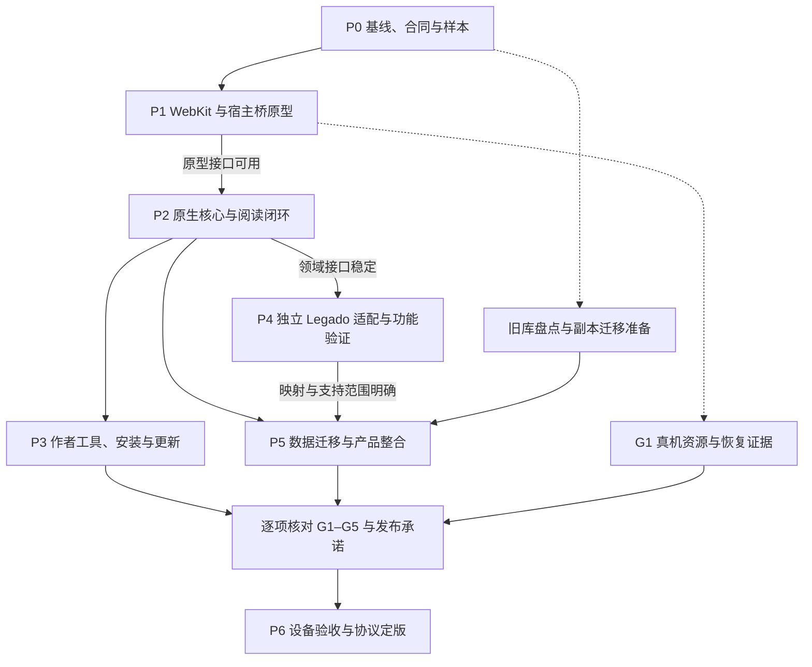

# 书源架构与协议实施流程

日期：2026-11-09（Asia/Hong_Kong）；初版：2026-11-08

状态：P0/P1 基线、P2 实验性阅读链路与 P3 调试/更新恢复自动化已交付，证据见 [P2 报告](reports/SOURCE_PROTOCOL_P2_REPORT.md) 和 [P3 报告](reports/SOURCE_PROTOCOL_P3_REPORT.md)。G1 真机资源、G2/G3 完整设备与作者体验、P4 独立兼容、P5 迁移和 P6 发布验收仍开放。当前任务与证据集中在第 13 节；未标明通过的任务不得视为已验收。

目标：将已确认的设计方向落实为可验证、可维护的 iOS/iPadOS 26+ 阅读器，提供自有单文件书源协议与独立的 Android Legado 兼容能力。

## 1. 使用方式与当前起点

本文回答“接下来按什么顺序做、每一步交付什么、怎样判断可以继续”。设计取舍和参考项目证据保留在架构提案中，作者接口以协议草案为起点，实施中产生的决定要回写对应规范。

| 文档 | 用途 |
| --- | --- |
| [架构提案](ARCHITECTURE_SOURCE_PROTOCOL_PROPOSAL.md) | 为什么选择这些边界，以及已有代码和参考项目的分析 |
| [协议草案](SOURCE_PROTOCOL_V1_DRAFT.md) | 初始接口设计与取舍；当前字段和运行约束以候选合同为准 |
| [候选合同](../protocols/source-v1/README.md) | schema/profile、类型与文字语义；修改接口时同步样本和实现 |
| [作者指南](SOURCE_AUTHOR_GUIDE.md) | 编写、构建、导入、调试与分享的可执行路径 |
| [单文件示例](examples/example.source.js) | 解释作者如何编写一个源；使用虚构站点 |
| 本文 | 实施顺序、工作包、验收门槛、测试和迁移流程 |
| [开发与验证](DEVELOPMENT.md) | 当前仓库已有的环境与命令 |
| [决策登记](reports/SOURCE_PROTOCOL_DECISIONS.md) | D01–D10 的选择、依据、剩余证据与重新评估条件 |
| [设备验证](SOURCE_RUNTIME_DEVICE_VALIDATION.md) | 真机/iPad 剧本、构建身份和待补设备证据 |

启动时只有架构分析、候选协议和静态示例；目前已有 App 实验入口、共享导入器、实际 WebKit 样本与原生阅读链路。各项结论只适用于报告记录的提交和样本，不能从既有 QuickJS 测试、一次构建或某个成功示例推导整个新协议已完成。

允许重新设计全部实现。复用现有代码的条件是符合新边界、能通过对应行为验证、维护成本合理；不以保留旧目录或类名作为目标。重写架构与丢弃用户数据是两个独立决定，迁移必须单独完成。

执行任务时使用本文的工作包编号记录提交、测试报告和未决项。每个阶段完成后更新状态并链接证据，不能只勾选功能清单。

2026-11-09 调整：自有协议正确性、iOS 旧源可用性、与指定 Android 版本的行为一致性分别验收。Android SDK/模拟器只服务于按需参考对照，不是自有协议、iOS 主线或 G4 功能验收的统一前置条件；实际支持范围仍须有样本和完整链路证据。

## 2. 已确定的方向与待验证的决定

### 2.1 实施基线

| 主题 | 已确定的方向 |
| --- | --- |
| 平台 | iOS/iPadOS 26+，Swift 原生应用和阅读体验 |
| 自有格式 | 一个可读、自包含的 `.source.js` ES Module；扩展名发布前正式确认 |
| 元数据 | 静态 `export const metadata`，通过 AST 提取；导入未知源不执行其代码 |
| 作者操作 | `book`、`chapters`、`content`；`search` 可选但推荐 |
| 分发 | 文件、文本、原始 URL；复杂项目在作者侧构建为可读单文件 |
| 运行环境 | 自有协议优先验证 WebKit；最终选择依赖真机证据 |
| 兼容 | 独立 `LegadoAdapter`，可拥有专用 QuickJS 后端，共享原生服务 |
| 领域边界 | 书架、进度、缓存、调度、正文规范化归原生核心；旧规则不进入阅读器接口 |
| 状态 | 引用可持久化，账号和安装实例隔离，运行固定使用源码与配置快照 |
| ORSP | 仅作定义设计参考；没有适配任务或后续适配计划 |

首版不包含运行时远程 JS 依赖、npm 包管理、加密分发服务、任意插件页面、常驻脚本服务或要求一个源同时在多个 JS 引擎上等价运行。发现、登录和媒体等能力按有证据的需要单独定义扩展。

### 2.2 必须关闭的决策项

下表是实施中的具体决策，不是重新讨论全部产品方向。任何影响作者行为的结论，都要进入协议正文和一致性样本。

| 编号 | 问题 | 关闭阶段 | 所需证据 |
| --- | --- | --- | --- |
| D01 | 静态 parser 的实现、语法版本、资源上限，App/CLI 如何保持一致 | P1 | 同一合法/非法语料在两端结果相同；不执行输入代码 |
| D02 | 本地 ESM 加载、origin、CSP、桥接和可用 Web API profile | P1 | 最低支持系统的真机报告 |
| D03 | 同步死循环、页面挂死和内容进程异常后的隔离与恢复 | P1 | 故障注入、资源变化、正常源恢复结果 |
| D04 | HTTP 响应体、编码、重定向、错误和有限重试语义 | P1/P2 | 固定响应样本和请求轨迹 |
| D05 | 稳定 ID、账号范围、缓存键、引用与源版本变化的关系 | P2 | 重启、切账号、更新和旧数据映射样本 |
| D06 | 正文规范化、允许的 HTML 子集、定位与重新排版 | P2 | 文档与位置恢复快照、TXT/EPUB 回归 |
| D07 | 来源更新、本地修改、同 ID 冲突、派生源与回滚交互 | P3 | 安装更新故障注入与完整操作录像/记录 |
| D08 | Legado 参考版本、支持范围、证据级别与已知差异 | P4 | 参考来源可追溯、固定样本及 iOS 完整链路；指定 Android 版本的一致性声明另附实际对照报告 |
| D09 | 旧库升级、账号状态保留、降级与恢复的支持范围 | P5 | 迁移前后逐项核对、崩溃与重试演练 |
| D10 | 最低设备上的资源与延迟预算、产品功能放行范围 | P1 初定，P6 复核 | 基线测量、预算依据和发布候选报告 |

D01–D10 的决定统一维护在 [决策登记](reports/SOURCE_PROTOCOL_DECISIONS.md)，记录问题、选择、证据、影响和重新评估条件。需要更长论证时再增加独立决定文档并从登记表链接，避免在多个文件重复维护不同版本的结论。

## 3. 阶段、依赖与验收门槛

下图表示实现所需的接口与样本依赖。功能可以在实验入口迭代，验收门槛决定能否扩大承诺、切换默认路径或发布；设备证据等待期间可继续不依赖该证据的工作。



Legado 样本、旧数据盘点和副本迁移演练可提前开展；P2 接口稳定后可实施 P4，无需等待所有 P3 设备交互完成。实验实现不自动关闭 G1–G5，旧库切换与稳定发布仍需对应通过证据。Android 对照属于 P4 的按需参考，不是图中的主线依赖；此处描述工作关系，不要求多人或多代理执行。

| 阶段 | 主要交付物 | 验收门槛 | 当前状态与证据 |
| --- | --- | --- | --- |
| P0 | 范围清单、候选 Schema、固定样本、现状基线、风险清单 | G0：最小源和预期行为可以明确说明与复现 | G0 已通过；真实数据/设备证据仍按项补齐，见 P0 报告 |
| P1 | iOS 原型、受控执行页、桥接、失败恢复、设备测量报告 | G1：运行方案有可复核的通过证据 | App/WebKit 原型与自动化已运行；G1 缺真机资源、隔离与恢复证据 |
| P2 | 原生领域接口、调度/存储/正文、完整阅读链路 | G2：重启和离线后仍保持正确阅读状态 | 进行中：阅读、账号、封面及诊断已实现；完整设备证据未关闭 |
| P3 | validator、类型、可选 builder、device runner、安装编辑更新 | G3：作者与用户的单文件使用闭环完成 | 自动化已通过：构建源 WebKit、错误定位、进程中断恢复；设备交互/作者分享仍缺证据，见 P3 报告 |
| P4 | 独立适配器、兼容矩阵、回归夹具、诊断 | G4：发布承诺范围内的 Legado 功能与完整链路通过 | 参考版本已固定；独立 adapter/完整链路待实施；Android 对照单列为按需证据 |
| P5 | 数据迁移、故障恢复、功能去留清单、App 整合 | G5：旧用户可迁移，失败可恢复 | 待开展 |
| P6 | 候选规范、设备回归、试用报告、发布说明 | G6：三个独立验收维度同时通过 | 待开展 |

三个独立维度是：作者体验、阅读正确性、运行时稳定性。某一维度通过不能替代另外两个。所有阶段都允许得到“不通过”的有效结果，但必须明确后续修改与重测范围。

不按未经验证的工期直接安排发布日。P0 后可估算任务规模，P1 后再估算总体计划；每阶段用已经交付的样本和测量校正。真机可用性与运行时隔离应在 P0 就暴露为依赖。Android 对照环境另记为可选参考条件，缺少该环境不阻塞自有协议或 iOS 功能实施。

## 4. P0：建立基线、补齐最小合同与样本

**目的：** 让后续开发围绕可复现的行为推进，避免先堆功能再发现协议缺口。

### 4.1 工作包

| 编号 | 工作 | 交付物与完成条件 |
| --- | --- | --- |
| P0-01 | 盘点现有能力与数据 | 功能表、数据表、已有测试映射；为每项标记保留、重做或延期 |
| P0-02 | 保存可复现基线 | Git 提交、工具链与系统版本、已有测试结果；脱敏数据库副本和固定响应 |
| P0-03 | 补齐候选协议 | Schema、文字语义与正反例；覆盖下方合同清单 |
| P0-04 | 设计最小领域接口 | 安装源、源快照、账号、引用、操作、正文、位置等类型；依赖方向草图 |
| P0-05 | 构造 fixture 站点 | 可切换响应的本地服务，记录请求；无需第三方站点账号 |
| P0-06 | 准备验证环境 | GitHub Actions macOS/Xcode runner、最低系统真机、iPad；必需环境缺项单独记录，Android 参考环境按需准备 |
| P0-07 | 建立决策与报告模板 | D01–D10 跟踪表、阶段报告、工作包完成模板 |

功能盘点至少包含：网络书籍、搜索与换源、源管理/订阅/调试、书架、目录更新、下载与离线、阅读进度/书签/笔记、TXT、EPUB、RSS、TTS、替换规则和现有设置。新架构演示不等于现有产品所有能力已迁移；每项都要明确处理决定。

### 4.2 最小合同清单

1. **模块与元数据：** 确定允许的导出形式、`metadata` 静态语法、文件大小和语法树限制、未知字段规则、缺少/重复导出的诊断。明确外部静态导入、动态导入、顶层异步初始化的处理。根据实际需要选择 ECMAScript 子集，不自行创造模块语法。
2. **身份与版本：** 区分安装实例、发布源 ID、源码摘要、账号、书籍和章节 ID；固定重复安装、同 ID 不同来源、旧引用迁移和派生源的处理。`apiVersion` 与作者 `version` 分工不变。
3. **结果数据：** 固定 Schema、必须字段、空字符串/缺失/null、未知枚举、重复 ID、JSON 深度/体积、字段路径错误。记录允许的兼容性演进方式。
4. **分页：** 明确 `nextCursor=null`、空页有下一页、重复游标、最大页数、目录 revision 变化；游标与源版本、账号、配置和查询绑定。
5. **正文：** 固定 text 换行与段落、HTML 子集、非法标记降级、单章完整性、大正文限制；按 fixture 对规范化结果作出唯一解释。
6. **HTTP：** 定义方法、headers、请求体、响应消费、编码、重定向、超时、取消和大小限制；区分 HTTP 非成功状态与传输失败。说明 `ctx.errors.http` 与协议错误类别的对应关系。
7. **状态：** 定义 `ctx.storage` 最小操作、配额、并发更新、账号切换、源更新和取消时的可见性。一次 storage 写入的原子性不等于整个脚本自动事务回滚。
8. **配置与错误：** 固定设置类型、默认值、校验、敏感配置边界，以及 NETWORK/RATE_LIMITED/AUTH_REQUIRED/PARSE/UNSUPPORTED/TIMEOUT/CANCELLED 等错误的结构和用户提示规则。
9. **生命周期：** 定义初始化预算、操作快照、deadline、取消、单次完成、结束后的宿主写入拒绝、迟到结果处理和运行时重建。
10. **能力 profile：** 列出基础 JS/DOM API 和扩展清单；未验证能力不成为隐含保证。不为每个源重复声明基础能力。

P0 冻结的是可供原型验证的小范围候选。P1/P2 发现问题可调整，修改必须同步 Schema、说明、示例和样本；对外承诺的 v1 在 P6 定版。

### 4.3 首批样本

| 样本 | 必须体现的行为 |
| --- | --- |
| A：静态 HTML 源 | 搜索、详情、两页目录、正文、下一章；`DOMParser` 和 URL 解析 |
| B：JSON API 源 | JSON 数据、请求头/请求体、搜索与目录游标、正文纯文本 |
| C：状态源 | Cookie/会话过期、配置切换、账号隔离、重启后恢复引用 |
| D：变化源 | 目录新增/删除/重排、同数量内容变化、分页期间 revision 改变 |
| E：故障源 | 网络中断、慢响应、无结果、解析失败、429/5xx、超大响应、重复游标 |
| F：运行时源 | 无穷 Promise、同步死循环、全局状态污染、迟到回调、未等待的请求 |
| G：分发样本 | 合法/非法 metadata、本地修改、同 ID 冲突、更新失败和回滚 |

先让 A 在受控环境下走通全流程，其余样本逐步进入对应阶段。修改源码示例时保留说明性用途；不要把虚构域名当成真实在线验收目标。

**G0 通过条件：** A 的输入、请求、输出和恢复行为可逐项说明；关键未决项有负责人或待决标记和关闭阶段；现有功能与数据去向没有遗漏。没有 iOS 环境时可继续规范和样本工作，G1 记录为缺少证据。

## 5. P1：WebKit 与原生宿主的垂直原型

**目的：** 尽早验证最容易迫使架构返工的部分。原型只需要开发入口、执行与诊断，不要求完成源管理界面。

### 5.1 实现顺序

| 编号 | 工作 | 验收重点 |
| --- | --- | --- |
| P1-01 | 静态导入器原型 | 将源文本作为数据解析；获得 metadata、入口和准确错误位置，不运行模块 |
| P1-02 | 受控执行页与 ESM 加载 | 固定源码快照；拒绝外部模块；初始化有预算；记录 origin 和实际 API 能力 |
| P1-03 | 类型化原生桥 | 消息有 operation/session 标识；参数与返回值校验；未知消息、超大数据和已结束操作被拒绝 |
| P1-04 | 最小 `ctx.http` 与上下文 | 真实原生网络往返；继承 deadline/取消；返回可用的文本/JSON/字节 |
| P1-05 | 端到端执行样本 A/B | 静态导入→初始化→四项操作→结果校验；设备输出与 fixture 预期对照 |
| P1-06 | 隔离、失效与恢复 | 故障注入 F，来源/账号/会话混用检测，异常会话淘汰与新操作恢复 |
| P1-07 | 资源与延迟测量 | 冷/热运行、并发档位、总内存、取消和恢复；形成 G1 报告与 ADR |

静态 parser 的实现可以复用成熟解析器，但须验证语法支持、许可、包体和资源边界。即使解析器运行在某个 JS 容器内，被解析的未知源也只能作为字符串输入，不得通过 `import`、`eval` 或执行顶层代码提取元数据。

### 5.2 执行页、网站页与网络边界

- 源执行页承载自有模块和宿主桥；真实网站导航/登录属于独立会话。网站脚本不能直接取得源执行页的宿主上下文。
- 为直接 fetch、XHR、WebSocket、图片/iframe、导航、worker、脚本标签和动态代码等入口建立允许/拒绝矩阵；不需要的入口关闭，需要的入口明确策略并实测。
- 验证 metadata 的 `origins` 能否贯穿原生请求、重定向、封面和浏览器子资源。不能只过滤 `ctx.http` 就宣称已限制所有外连。
- 执行世界、DOM、Cookie、原生凭据和操作身份分别验证隔离。来源/账号切换必须清除或更换相关运行状态。
- `ctx.http` 的能力由自身合同定义；浏览器原生 fetch 的存在不能作为原生桥已经完成的证据。
- 真实页面登录原型只证明已测的会话衔接。需要浏览器绑定状态的站点，不能靠“复制 Cookie 成功”推导全部兼容。

### 5.3 必须分开验证的取消行为

| 层次 | 需要观察的结果 | 不足以证明通过的现象 |
| --- | --- | --- |
| 业务调用 | 一次性返回 CANCELLED/TIMEOUT，UI 不接收旧结果 | 仅在界面隐藏加载动画 |
| 原生请求 | 未完成请求被取消，后续请求不再获准启动 | Promise 不再等待响应 |
| 宿主状态 | 已结束操作不能继续写 storage/缓存/当前结果 | 日志显示操作结束，但桥仍接收写入 |
| JS 计算 | 同步死循环对其他任务的影响与持续时间被测出 | `Task.cancel()`、Promise 超时或 `stopLoading()` 返回 |
| 资源恢复 | 问题会话被隔离，新会话可用，总资源回到确定范围 | 创建了新 WKWebView 但旧计算仍持续占用 |

操作结束不应阻止已经成功提交的数据被读取，但不得允许游离回调继续修改状态。已发送到服务器的请求是否生效属于另外的业务语义，不能承诺取消会撤销远端副作用。

### 5.4 测量方法与 G1 决策

最低设备选择一台能运行 iOS 26 的较低内存目标机，并记录实际型号；同时验证 iPad 和另一台有代表性的设备。模拟器用于快速调试，不代替最低系统真机的内存和恢复结论。

记录冷启动与会话复用两组数据。使用相同 fixture、响应大小、请求延迟和设备状态，对并发 1/2/4 等候选档位做探索；这些数字是实验档位，不是最终产品设置。分别记录源码加载、初始化、原生请求、DOM/数据解析、桥接、首批有效结果、总完成时间、取消和恢复耗时。

资源记录包含 App 与可观测 WebContent/网络进程的内存、峰值与操作结束后的回落，以及可取得的 CPU/能耗信息。不能只报告 Swift 进程内存。报告说明采样工具、轮数和局限；样本不足时不包装成可信的 P95 结论。

在正式验收轮次前记录允许的延迟、内存、最大响应和恢复预算及其依据，避免测完后随意修改通过线。探索数据用来制定预算，验收数据用来验证预算。

**G1 通过条件：** 样本 A/B/F 覆盖所需 API、网络、结果、故障与恢复；来源边界无未解释的突破；普通源不会被一个异常源无限拖住；测量达到已确定预算。所有缺口必须标注是否阻断 v1。

**G1 不通过时：** 先判断是桥接/配置实现问题，还是执行模型无法满足目标。前者修复后重跑受影响样本；后者暂停扩大迁移，缩减未必需能力或重新评估执行方案，并验证同一组合同与样本。仅降低并发或更换 JS 引擎名称不能自动解决取消与隔离问题；若关键保证做不到，应如实调整产品边界。

## 6. P2：建立原生核心并打通完整阅读链路

**前置条件：** G1 通过，运行环境 profile 和资源策略有可用结论。

### 6.1 模块与接入边界

以下是职责名称，不要求立即拆成独立 Swift Package。

| 边界 | 负责 | 接口中应排除 |
| --- | --- | --- |
| `SourceContracts` | 源身份、操作输入/结果、能力、错误和可持久化引用 | WKWebView、QuickJS 对象、Legado DSL |
| `SourceRuntime` | 会话、模块、桥接、操作生命周期和资源预算 | 书架 UI、阅读页状态 |
| `SourceAdapters` | 自有协议/Legado 结果转为统一合同 | 修改阅读器内部状态 |
| 原生宿主服务 | 网络、Cookie/凭据、源状态、调度、日志 | 依赖任意源的全局 JS 变量 |
| `LibraryKit` | 搜索聚合、书架、目录更新、缓存、下载和预读 | 直接解释 `java.*` 或站点规则 |
| `ReaderKit` | 正文规范化、排版、位置、翻页、EPUB 路径 | 网络抓取规则和源脚本引擎 |
| App 装配层 | 创建实现、依赖注入、界面与系统生命周期 | 在页面中拼接具体书源抓取流程 |

可从现有代码提取符合要求的实现，但不能让新的 `BookSource` 别名继续携带整个旧规则模型。领域接口要真正独立。

### 6.2 工作包

| 编号 | 工作 | 关键完成条件 |
| --- | --- | --- |
| P2-01 | 定义协议无关领域接口 | 用自有源和不依赖引擎的假实现都能调用搜索/详情/目录/正文 |
| P2-02 | 原生网络与调度 | 全局与站点并发、前台优先级、deadline、限流、有限重试和所有入口统一策略 |
| P2-03 | 身份、数据库与缓存 | 稳定安装/书籍/章节 ID；来源/账号/版本范围明确；缓存不能跨账号误命中 |
| P2-04 | 目录更新与一致性 | 去重、重复游标保护、revision 改变、新增/删除/重排和同数量更新 |
| P2-05 | 正文规范化与位置 | text/HTML 转成内部文档；保存规范化版本和文本锚点；重新排版恢复 |
| P2-06 | 搜索到阅读闭环 | 单源→多源渐进搜索→详情→目录→正文→翻章→预读→重启→离线 |
| P2-07 | 错误与诊断 | 空结果/失败可区分；取消、认证、限流、解析错误有对应恢复入口 |
| P2-08 | 本地阅读回归 | TXT 和 EPUB 保持各自模型；网络源重构不破坏已有本地书行为 |

### 6.3 必须落实的细节

**操作状态与会话状态分开。** 操作至少经过排队、执行、成功/失败/取消/超时；终态只发生一次。会话至少区分初始化、可用、失效、回收。用原生 operation ID、源码摘要、配置版本和账号范围校验回调，不能仅相信源传回的字符串身份。

**快照范围明确。** 单次操作始终固定源码和配置。目录多页等一致性流程应固定同一源快照；更新发生时完成旧流程或整体重启，不能混合结果。搜索得到的引用进入新版本后如果无法解析，返回明确的刷新/迁移问题，不能默默匹配到同名书。

**缓存与更新分层。** 身份、内容修订、提取版本、规范化版本和布局缓存分别管理。确定哪些变化失效哪一层；不要在源码更新时不加区分地清空所有离线内容，也不要继续把旧输出冒充新结果。账号切换后私有缓存是否保留和可读，必须有明确策略。

**网络恢复保守。** 建立一处可追踪的重试策略，避免源、适配器和宿主同时重试放大流量。只重试适合重试的操作；处理 `Retry-After`、截止时间、总尝试预算。源主动请求和封面加载均纳入限额，桥接与 HTML 解析的字节放大也计入资源测试。

**阅读位置稳定。** 页码只属于当前布局。字号、设备方向、章节修订和目录重排后，通过章节身份与文本锚点恢复；找不到时给出可解释的就近定位或选择入口。EPUB locator 继续使用独立语义，不强行压成纯文本章节下标。

### 6.4 G2 验收剧本

1. 导入受控源 A/B，搜索并加入书架，加载两页以上目录，读取正文和下一章。
2. 完成下载后终止 App；离线重启，恢复书架、目录、正文和阅读位置。没有下载的章节给出明确状态。
3. 改变字号/横竖屏，恢复到同一文本附近；重复章节标题不造成身份混淆。
4. 模拟目录删除、插入、重排、同数量变化和分页期间版本变化，验证进度、缓存和更新提示。
5. 同时搜索多个源后更换关键词/取消，旧回调不能覆盖新结果；坏源不阻塞全部结果。
6. 切换账号和配置、清理会话，再用持久化 ref 读取；不得依赖上一次 search 的 VM。
7. 以同一批 TXT/EPUB 夹具验证导入、目录、进度和正文；核对原有阅读行为基线。

**G2 通过条件：** 上述链路有自动化覆盖与必要设备记录；数据模型和接口不再把 Legado 字段传入新阅读流程；数据库/缓存范围与错误恢复语义已写回规范。

## 7. P3：作者工具、单文件分发与编辑更新

**目的：** 让简单源可直接编写，让复杂源的工具链可选，同时保证用户手里的源码完整可读。

### 7.1 作者工具的交付顺序

| 编号 | 工作 | 完成条件 |
| --- | --- | --- |
| P3-01 | 固定输出 Schema 与类型 | JS/JSDoc、TypeScript 与 Swift 映射来自同一规范；生成物可检查是否过期 |
| P3-02 | validator | 不执行输入代码的静态检查，错误带行列/字段路径；运行期结果另行校验 |
| P3-03 | fixture runner | 固定请求/响应、时间/错误场景、预期输出；默认不访问真实站点 |
| P3-04 | device runner | 同一源与样本在目标 WebKit 执行，记录与 CLI 的差异 |
| P3-05 | 可选 builder | TS/多文件→格式化、自包含模块；无外部导入；metadata 可提取；保留许可 |
| P3-06 | 教程与调试器 | 一份无构建 JS 教程、一份复杂源构建教程；从错误定位到源码并重跑 |

CLI 的快速测试与设备行为分别报告。mock DOM 通过不能等同于实际 DOM/网络桥通过。类型生成若必须保留手写部分，列明边界并用共享样本检验漂移。

### 7.2 安装与更新工作包

| 编号 | 工作 | 完成条件 |
| --- | --- | --- |
| P3-07 | 文件/粘贴/URL 导入 | 同一字节内容得到相同验证结果；保存安装实例、来源和摘要；未知版本可解释地拒绝 |
| P3-08 | 原生设置和编辑 | settings 生成有限类型表单；源码可查看、修改、验证、导出；凭据独立存放 |
| P3-09 | 更新、冲突与回滚 | 完整执行下方更新流程；本地修改不被静默覆盖；恢复上一个可用源码 |
| P3-10 | 可选源索引 | 核心流程不依赖它；若纳入首版，只做纯数据目录并复核下载源码元数据 |

更新推荐流程：

1. 下载候选文件到暂存区，记录实际 URL、内容摘要与当前安装记录。
2. 静态检查 metadata、入口、所需能力和来源范围；下载的代码此时仍未执行。
3. 对比版本、摘要、本地修改、ID 和权限差异。相同 ID 不等于可信的同一发布者；来源变化不能自动取得替换权。
4. 有本地修改时，提供保留本地、接受上游、查看差异或另存派生源的明确操作；敏感设置不写入导出文件。
5. 将候选写为不可变快照，再以数据库事务切换“活动快照”指针；保留旧快照直到没有运行引用且满足回滚策略。
6. 在途操作继续使用已绑定快照；下一次操作按更新策略选择版本。实际运行失败能定位到对应摘要，不把导入成功解释为网站可用。
7. 启动恢复时检查暂存和指针一致性；孤立文件可以清理，但不能误删仍被书架、任务或回滚记录引用的快照。

文件写入和数据库修改不是天然的跨介质原子事务。必须在“下载后、写入后、切换前、切换后”分别注入中断，验证恢复逻辑。脚本回滚也不意味着 storage/账号状态自动回滚；兼容策略在实现前明确，并保留必要状态快照或拒绝不安全的恢复组合。

### 7.3 G3 验收

- 作者只用普通编辑器写单文件 JS，无脚手架也能导入、调试、分享和安装到另一台设备。
- 复杂项目构建后只分享一个可读文件；静态元数据与行为样本仍通过，不产生第二份 manifest 真相。
- 本地改动、上游更新、同 ID 冲突、权限扩大、更新中断和回滚分别有样本。
- 导出不包含 Cookie、令牌、私人配置、书架或正文；不能把用户实例数据意外拼回源文件。
- 错误能定位到操作、字段和源码；诊断信息有范围限制，正常日志不记录凭据或整章正文。

**G3 通过条件：** 上述作者、安装、编辑和更新场景全部有可复现记录；最简单的源无需构建工具，构建源的最终文件仍可独立分享；CLI 与设备验证的适用范围清楚，本地修改和回滚行为符合合同。

## 8. P4：独立 Legado 适配与兼容验证

**目的：** 保留既有源的实际可用性，同时让历史规则语义只存在于适配边界内。

### 8.1 工作包

| 编号 | 工作 | 完成条件 |
| --- | --- | --- |
| P4-01 | 锁定参考来源与支持范围 | 阅读参考版本/提交、样本与预期结果来源、许可证可追溯；运行 Android 时再记录其环境 |
| P4-02 | 选择代表语料 | 按规则能力与使用场景分组，区分自造夹具、脱敏录制与线上源 |
| P4-03 | 实现适配边界 | 原始源 JSON 和扩展字段可保存；内部结果映射统一领域合同 |
| P4-04 | 整理同步宿主与网络 | `java.*` 和 DSL 留在适配器；所有请求纳入宿主作用域、预算、取消与诊断 |
| P4-05 | 样本回归与按需对照 | 固定输入/响应/状态及经确认的预期结果，验证 iOS 请求、输出、变量和错误；有具体语义歧义或一致性承诺时补 Android 对照 |
| P4-06 | 发布兼容矩阵 | 支持/部分支持/不支持、证据来源与级别、已验证范围、差异与用户提示一一对应 |

优先复用已被夹具证明正确的解析和宿主实现；需要重写的部分同样接受确定性回归与 iOS 完整链路验证。已有移植项目可提供设计经验和候选样本，数量不能代替本项目的兼容证据。不要通过机械加 `await` 转换同步脚本，也不要通过整段重放掩盖网络异步差异而忽视重复副作用。

### 8.2 兼容矩阵的最低内容

| 能力组 | 需要覆盖 |
| --- | --- |
| 基础提取 | HTML/CSS、XPath、JSONPath、正则及规则组合 |
| URL 与请求 | 模板、查询/表单/JSON、headers、重定向、编码、Cookie、分页 |
| JS 与宿主 | 常见 `java.*`、变量范围、jsLib、异常、同步求值顺序 |
| 状态与恢复 | 搜索到正文的变量、重启恢复、账号变化、旧 URL 身份映射 |
| 浏览器依赖 | 真实登录/动态内容的明确支持边界，无法支持时有诊断 |
| Android 专属 | 反射、包类或平台行为逐项标记，不默默返回空值装作成功 |

每个兼容条目分别记录支持状态与证据级别：静态分析、固定样本通过、iOS 完整阅读链路通过、与指定 Android 版本对照通过。静态分析不能单独证明支持，导入成功和简单搜索成功也不能替代完整兼容判断；只有实际对照过的样本可以声明对应版本的行为一致性。

已有 QuickJS 限额测试只证明对应路径；适配器内部的同步宿主网络、原生分配、HTML 解析和桥接仍要纳入预算。排查线程阻塞与取消传播，不能让兼容模式绕开新调度器。

旧源缺少稳定 ID 时保留原始信息并维护映射。不可盲目删除 URL 参数，也不可把重复标题/目录下标当唯一键。跨源换源由原生应用提供候选匹配，不在适配器内自动合并用户书籍。

### 8.3 功能验收与 Android 参考对照

**G4 功能通过条件：** 发布宣称支持的能力均有可追溯的参考依据、固定样本及 iOS 测试证据；至少覆盖搜索→详情→目录→正文→重启的兼容链路，并验证承诺范围内的账号、取消和故障处理；支持范围与已知差异透明；原生核心和新协议中没有混入 Android 宿主 API。没有 Android 运行记录不单独阻止 G4 功能验收，但不得把未解决且影响承诺范围的语义问题标成支持。

Android 对照是独立证据项。出现文档/源码无法确认的规则歧义、旧源在两端结果不同、参考版本升级影响语义，或明确承诺某项 Android 行为一致时，再决定对照范围。该范围内缺少有效记录，就保留“未对照/待验证”，不能标记差分通过；其他已验证能力和自有协议继续推进。

常规兼容回归应使用固定输入、响应、状态与经审查的预期输出，记录参考提交、输入摘要、预期来源和有意差异。实际 Android 结果可以采集后持久保存并由 Swift 重放比较，无需每次启动 Android。仅由当前 iOS 输出生成的快照只能证明行为未变化，不能独立证明兼容正确。现有探针和比较器保留；持久预期数据及无 Android 的自动回归接线属于后续实现，本次文档调整不视为已交付。

Android SDK/模拟器不加入常规 push/PR 或发布构建的必需依赖。现有手动参考工作流按需使用，构建环境失败与兼容失败分别记录；后续投入应对应具体兼容问题。详细证据格式和使用流程见 [独立兼容基准](../protocols/legado-compatibility/README.md)。

## 9. P5：数据迁移、应用整合与旧路径退出

**目的：** 让新架构承接真实使用，不因重写损失书架和阅读状态。

### 9.1 迁移对象与核对方式

| 对象 | 迁移要求 | 核对方式 |
| --- | --- | --- |
| 源与订阅 | 原始 JSON、未知字段、名称/分组/启用状态、来源、用户修改 | 数量、原文摘要与安装映射 |
| 书架 | 稳定本地书籍 ID、来源关系、排序/分组、封面定位 | 逐条映射，无法识别的条目保留待处理 |
| 目录与进度 | 旧 URL/索引→新章节引用、文本位置、最后阅读 | 重复标题/重排/已删章样本；不得猜测后静默覆盖 |
| 书签/笔记/记录 | 保留文本与定位关系、时间及必要统计 | 逐项比对和不可定位时的保留策略 |
| 正文与离线 | 缓存身份、正文版本、下载完整性 | 离线启动和指定章节读取 |
| TXT/EPUB | 本地文件与授权、出版物身份、locator、必要资源 | 导入过的旧书重新打开 |
| 登录状态 | Cookie/凭据与账号作用域、过期和缺失处理 | 能保留的安全保留；需重新登录的明确提示 |
| 配置与规则 | 阅读设置、替换规则、其他功能的保留/转换决定 | P0 功能表逐项关闭 |

凭据迁移属于受控的本机迁移流程，不混入可分享书源或普通诊断报告。无法可靠迁移的账号状态不能伪造成登录成功。

### 9.2 工作包与执行步骤

| 编号 | 工作 | 完成条件 |
| --- | --- | --- |
| P5-01 | 制定版本化迁移映射 | 旧实体→新实体的键、缺失数据和不支持状态都有处理规则 |
| P5-02 | 实现可恢复迁移 | 分步日志/检查点、重复运行不重复导入、中断后继续或恢复 |
| P5-03 | 迁移副本演练 | 空库、普通库、大库、缺字段/局部损坏库均有报告 |
| P5-04 | App 接入与功能盘点 | 搜索、书架、源管理、阅读和保留功能接入新服务 |
| P5-05 | 移除已替代路径 | 只有新路径验收通过后再移除；保留需要的旧数据读取/恢复能力 |
| P5-06 | 迁移与恢复说明 | 用户可理解的失败提示、重试/恢复方式，以及明确的降级限制 |

推荐顺序：备份旧数据并记录版本→生成新结构与映射→迁移副本→核对数量、关系和关键内容→完成整套阅读验收→切换活动存储→保留恢复材料。对磁盘不足、进程终止、部分文件丢失、重复启动分别做故障注入。

“可恢复旧快照”与“可无损降级旧 App”必须区分。用户已经在新版本产生笔记/进度后，直接恢复旧库会丢失这些新增内容；若没有实现双向迁移，就明确说明恢复边界并提供新数据备份。不要用保留一个旧数据库文件来宣称全部回滚完成。

迁移不要求一次性重写所有页面。可以在装配层逐步替换服务、用开关切换验证；旧行为只作为回归参照，不进入新合同。临时并存路径要登记删除条件，避免成为长期双套业务实现。

**G5 通过条件：** 代表性旧数据迁移后可搜索、阅读、重启和离线恢复；进度/笔记有核对证据；中断和重试可恢复；P0 功能表的每项都已经完成或得到明确的版本范围决定。

## 10. P6：试用、协议定版与发布

### 10.1 工作包

| 编号 | 工作 | 完成条件 |
| --- | --- | --- |
| P6-01 | 冻结 v1 候选 | Schema、profile、示例、文档与实现一致；列出延期扩展 |
| P6-02 | 完整回归 | 协议、核心、兼容、迁移、阅读器和 UI 的适用测试全部完成 |
| P6-03 | 设备与长时间运行 | 前后台切换、系统回收、弱网、连续阅读/下载、内存与能耗报告 |
| P6-04 | 作者试用 | 无工具 JS 源与构建源各完成一次由编写到分享更新的全过程 |
| P6-05 | 用户试用 | 新安装和旧数据升级两条路径；反馈可关联源码摘要和诊断阶段 |
| P6-06 | 发布材料与恢复演练 | 兼容矩阵、已知限制、版本说明、恢复方案和第三方声明齐备 |

### 10.2 阻断发布的条件

- 未知源码在静态导入时被执行，或者来源/账号边界存在未解决的串用。
- 普通阅读被异常脚本持续阻断，且没有达到已约定的隔离与恢复条件。
- 取消后旧结果覆盖当前状态，或未结束的副作用继续修改宿主数据。
- 目录/缓存/阅读进度发生不可解释的错配，用户数据迁移可能静默丢失。
- 本地修改被自动更新覆盖，或未验证候选替换了可用源码后无法恢复。
- 对外宣称兼容的能力缺少对应验证，或已知不兼容被显示为空搜索/空正文。
- 任一关键性能/资源预算尚未确定或验收未通过。

普通的新增能力需求可以延期；正确性、恢复和已作出的兼容承诺不能靠修改发布文案掩盖。若要缩小首版范围，先明确产品行为、用户影响和更新后的验收，再重新判断。

**G6 通过条件：** 作者体验、阅读正确性、运行时稳定性分别有通过记录，迁移完成且剩余问题有明确影响范围。实际发布是独立执行步骤，本文不表示已经发布或授权任意外部发布操作。

## 11. 跨阶段测试与证据管理

### 11.1 测试矩阵

| 层次 | 核心问题 | 环境/方式 | 开始阶段 |
| --- | --- | --- | --- |
| 静态合同 | 能否不执行代码地确定元数据/入口，非法输入能否准确拒绝 | App/CLI 共享正反例；parser 限额样本 | P0/P1 |
| 数据与正文 | 输出、分页、引用、文本规范化是否确定 | Schema/领域测试、固定 HTML/JSON | P0/P2 |
| 宿主网络 | 请求、编码、Cookie、重试、限额和取消是否符合合同 | 本地可控响应服务、请求轨迹 | P1/P2 |
| 运行时 | ESM/API、隔离、死循环、资源与恢复 | iOS 真机故障注入；模拟器辅助 | P1 |
| 阅读链路 | 搜索到离线恢复是否保持身份和进度 | 模型集成测试、UI 流程、设备抽查 | P2 |
| 分发工具 | 编辑/构建/分享/安装/更新是否完整可读 | 端到端作者样本、更新中断 | P3 |
| Legado 功能 | 声明范围内的旧源是否可用且无回归 | 固定样本、请求/状态记录、iOS 完整链路 | P4，语料始于 P0 |
| Legado 参考对照（按需） | 指定版本/样本的行为是否一致 | Android 实测或带来源的已采集结果；差异单列 | P4，具体歧义或一致性承诺触发 |
| 数据迁移 | 是否保留数据并可恢复 | 多版本数据库副本、故障注入 | P5，盘点始于 P0 |
| 产品发布 | 是否满足最低设备和完整功能范围 | 设备矩阵、受控试用、发布候选验证 | P6 |

真实站点验证单独记录时间、源版本、账号条件和网络环境；它用于检验现实适用性，不能替代确定性回归，也不应成为所有离线测试的外部依赖。记录站点样本时去除凭据与个人数据。

### 11.2 当前可复用的仓库入口

这些是现有实现/测试位置，用于基线和重构映射，不是新架构必须保留的目录结构。

| 当前入口 | 后续用途 |
| --- | --- |
| `Sources/LegadoCore/Book/NetworkBookService.swift` | 找出业务流程与 Legado URL/规则解析的耦合，建立替换基线 |
| `Sources/LegadoCore/Book/ChapterContentCache.swift` | 缓存接口、来源作用域与正文版本的改造对照 |
| `Sources/LegadoCore/RuleEngine/JavaScriptRuleEvaluator.swift` | 同步宿主、取消、请求入口与运行时生命周期的兼容梳理 |
| `Sources/LegadoCore/Persistence/LegadoDatabase.swift` | 旧实体与迁移映射 |
| `Tests/LegadoCoreTests/` | 规则、网络、源导入、状态、缓存和数据行为回归 |
| `Tests/LegadoAppModelsTests/` | 搜索/书架/阅读模型接入后的回归 |
| `Tests/LegadoReaderTests/`、`Tests/LegadoReaderUITests/` | 阅读器、EPUB、UI 和文件导入链路 |
| `scripts/self-check.sh` | 当前仓库完整自检入口 |

### 11.3 验证命令与环境边界

现有验证命令见 [开发与验证](DEVELOPMENT.md)。在对应 macOS/Xcode 环境中按变更范围执行，例如：

```sh
swift test --disable-sandbox --filter LegadoCoreTests --no-parallel
swift test --disable-sandbox --filter LegadoAppModelsTests --no-parallel
xcodebuild -project Legado.xcodeproj -scheme Legado \
  -destination 'generic/platform=iOS Simulator' \
  -derivedDataPath DerivedData CODE_SIGNING_ALLOWED=NO build
```

模拟器构建成功不等于 UI 测试成功，也不等于真机运行时验收。新 parser、协议 CLI 和 device runner 的命令应在工具交付后加入开发文档；现在不预写仿佛已经可执行的命令。

当前开发机是 Windows 11，Swift 编译和模拟器测试均通过 GitHub CI；实际运行 ID、提交与通过范围写在阶段报告。Source Runtime WebKit 与 Build Unsigned IPA 在完整集成节点手动执行，不为每次小提交重复启动。Legado Compatibility Reference 仅在需要参考证据时手动运行，不作为这些集成节点的统一前置任务。仅改文档时检查链接、格式、术语和相互一致性；代码阶段再运行对应行为测试，不用无关测试代替必要验证。

### 11.4 统一证据格式

每份阶段报告至少记录：工作包与门槛编号、代码提交、协议版本、源文件摘要、fixture 版本、设备/系统/工具链、运行方法、预期与实际、重复次数、结果、限制、遗留问题和后续决定。

故障记录另外保存 operation ID、源快照、账号作用域的非敏感标识、执行阶段、错误码与经过脱敏的请求摘要。诊断导出控制大小，不默认保存密码、Cookie、token、完整书籍内容或个人书架。

门槛状态只能写“未开始 / 进行中 / 通过 / 未通过 / 缺少证据”，并链接报告。实现进度另记“待实现 / 实现中 / 已实现”，设备等待写清所需环境与可继续的独立工作；环境失败和缺证据不等同于产品行为未通过。不得把“已实现”“模拟器跑过”“一次线上成功”直接替换成“已验收”。

工作优先级与阶段门槛集中维护在本文；决策登记保存选择与依据，报告保存对应提交的历史结果，设备文档保存剧本和实测记录。后续证据补齐时更新状态并链接结果，历史失败不删除。同一报告的早期“待验证”若已由后文解决，应加说明，避免被当成新的待办。代码提交、测试提交、工作流实际 checkout 和 IPA 构建身份分别记录，不能跨提交沿用结论。

## 12. 每个工作包的执行流程

1. **读取上下文。** 明确对应阶段、协议条款、已有测试与前置门槛；确认仓库现有改动，避免覆盖别人的工作。
2. **定义可观察的完成条件。** 写清一个输入、预期请求/输出/状态，以及关键失败场景。涉及协议变化时先更新候选合同。
3. **完成最小连贯实现。** 优先交付能走通的垂直路径，不先建立大量没有实际调用的抽象；测试只覆盖真实风险和约定行为。
4. **验证。** 先跑受影响的合同/核心测试，再跑相关集成、UI 或设备测试。只有新增修改、失败或未决风险才需要扩大/重复验证。
5. **检查边界。** 核对领域是否仍独立、是否绕过统一宿主、是否依赖 VM 隐式状态，以及更新/取消/重启后的行为。
6. **同步产物。** 更新 Schema、生成类型、示例、开发说明和兼容矩阵中受影响的部分；保持新旧文档适用范围清晰。
7. **提交可审阅成果。** 一个提交或 PR 解决一个连贯问题，描述最终行为、验证证据和限制；临时开关写明移除条件。
8. **更新工作包状态。** 未通过或缺证据时记录具体原因、阻断范围与下一步；仅解锁已满足实际依赖的任务，独立工作可继续。涉及取舍的结论写入决策登记，不只留在聊天中。

建议按工作包形成审阅边界，例如“静态元数据与共享语料”“执行页和 ESM”“原生 HTTP 与取消”“目录与恢复”“更新与本地编辑”。不要把所有重写代码放入一个无法分辨行为变化的大提交，也不要求每个小函数都单独提交。

工作包完成记录模板：

```text
编号与目标：
前置接口/门槛与阻断范围：
输入/样本：
最终行为与变更范围：
代码/规范/文档：
验证环境与结果：
未覆盖项与影响：
决定与证据链接：
实现状态 / 验收状态 / 下一项工作：
```

## 13. 当前执行清单与历史起点

初始清单建立于 2026-11-08，状态核对于 2026-11-09。历史基线见 [P0 报告](reports/SOURCE_PROTOCOL_P0_REPORT.md)，原型进度见 [P1 报告](reports/SOURCE_PROTOCOL_P1_REPORT.md)。已勾选项仅表示括号内范围完成；当前下一步见本节后续任务表：

- [x] P0-01（静态盘点）：列出现有功能和用户数据的完整去留表。
- [ ] P0-02：提交/锁文件、Node/合成 SQLite 已记录；GitHub Swift 回归已通过；真实脱敏样本仍缺。
- [x] P0-03（候选合同）：补齐 Schema、错误、HTTP、storage、分页和规范化语义。
- [x] P0-04（接口草图）：定义不携带 Legado/WKWebView 类型的领域接口草图。
- [x] P0-05（本机 fixture）：准备 HTML/JSON 两个确定性源，以及状态、变化和故障响应。
- [ ] P0-06：已明确 Windows 11 本地开发、GitHub CI 编译；CI 基线已通过；iOS 26 真机和 iPad 的完整设备证据仍需补齐；Android 对照单列为按需证据，不计作此项的必需环境缺口。
- [x] P0-07：登记 D01–D10，建立基线和阶段报告。
- [x] G0（进入原型，设备证据另验收）：审阅最小合同与样本，记录可启动原型的结论。
- [ ] P1-01～P1-04：App 静态导入、受控 ESM、类型化桥和带取消的无账号 HTTP 原型已实现；自动化与设备验收范围见 P1 报告。
- [ ] P1-05～P1-07：已加入 HTML/JSON 完整操作和故障恢复的模拟器测试；真机硬终止、资源/延迟测量和 G1 决策仍待完成。

首个可演示里程碑应是：**在 iOS 26 真机导入一个可读的单文件源，完成搜索、详情、分页目录与正文；取消和故障后还能继续正常运行，并有请求、结果和资源报告。** 当前原生阅读、作者工具等实验实现已经提前推进；缺少设备专项证据仍阻止对应正式承诺，不要求撤回实验实现或暂停独立开发。

### 2026-11-09 后续执行状态

原生网络/分页、目录索引和正文容量已有核心、WebKit 与 IPA 证据。账号 UI、Keychain、网页登录、封面和分类诊断已接入。账号集成基准 `d910c66` / 42511879648 的 37 项 WebKit 测试通过；封面/诊断基准 `9cb8ceb` / 42536126388 的 453 项核心、74 项 AppModels 和 App 编译通过。新的集成基准 `2ce7878` / 42536722241 已通过 57 项实际书源和本地阅读器测试；5 张截图已复核。更新事务故障补证 `39aa26b` / 42537259599 已通过 456 项核心、74 项 AppModels 和 App 编译。IPA 42537803211 的实际产品构建为 `2ce7878`，已完成包体校验；`39aa26b` 仅增加测试，不能写成该 IPA 的构建来源。结果见 [P2 报告](reports/SOURCE_PROTOCOL_P2_REPORT.md)。

用户已反馈真机安装和功能预览正常，但未提供对应构建、机型和系统版本。这是实际使用反馈，不能归到后来新增的账号/封面/诊断代码，也不能代替 G1 资源与故障恢复记录。G1、G2 和整个 P2 仍保持开放。

当前按以下任务推进。实现与验收分开记录，已通过的自动化仅在受影响代码改变、失败或新增风险时复跑：

| 工作包 | 已有证据或状态 | 下一项与完成条件 |
| --- | --- | --- |
| P2 集成基线 | `2ce7878`：57 项 WebKit/本地阅读、5 张截图及对应 IPA；`39aa26b` 补事务恢复测试 | 保留基线，按新变更范围回归；不重复创建相同功能的实现任务 |
| P2/G2 设备补证 | 账号、封面、诊断、阅读已有模拟器证据；设备完整验收仍缺 | 对明确构建记录账号/登录取消、封面/诊断、离线/重启、TXT/EPUB 及真实 iPad 交互；可与独立实现并行推进 |
| P3/G3 作者体验 | `c3af1d0`：构建源 WebKit/错误定位与真实进程恢复通过，59 项集成测试；见 P3 报告 | 补诊断详情/历史缺失、更新冲突/失败重试、设备恢复和两台设备间单文件分享；需要新设备验证时构建含 P3 改动的 IPA |
| P4 兼容主线（当前实现重点） | 参考版本、28 项初始规则语料和两端探针已建立；完整 provider 尚未验收 | 实现独立 provider 与统一宿主作用域/取消，审查持久预期并接入 Swift 回归，验证 iOS 完整链路并发布支持矩阵；Android 按具体问题补证 |
| P5 迁移准备与恢复 | 数据盘点和合成旧库已建立，实际迁移仍待完成 | 可先做副本映射/故障演练；验证实体、账号、进度、缓存与重试恢复，默认切换前满足 G5，不提前覆盖旧库 |
| G1/P6 运行时与发布 | G1 真机资源/故障专项与最终产品门槛开放 | 最低目标 iPhone 与真实 iPad 测量资源、取消、恢复及可用性，分别核对 G1–G5 和发布承诺；通过后再调整默认入口与稳定接口 |

可独立开展的核心、作者工具和副本迁移工作继续进行；涉及默认入口切换、旧库写入或稳定协议发布时，核对对应验收证据。Android 参考构建失败不作为整条实施链的停止条件。

详细行为与边界同步在 [P2 报告](reports/SOURCE_PROTOCOL_P2_REPORT.md)、[领域边界](../protocols/source-v1/DOMAIN_BOUNDARIES.md) 和 [设备验证步骤](SOURCE_RUNTIME_DEVICE_VALIDATION.md)。

### P3 调试与恢复、P4 基准的推进记录

P3 新增实际运行错误行列、按准确摘要查看当前/历史源码、显式实验室重试，以及作者侧可选映射。多文件成品仍是独立可读 .source.js。进程中断通过真实 Swift SourceArchive 子进程进行，已经验证 before/during/after 三种恢复。验证细节、首次失败与限制见 [P3 报告](reports/SOURCE_PROTOCOL_P3_REPORT.md)。

P4 已固定 LegadoTeam/legado 3.26101819 / a7d37f1707a70a459ad708f4fe79341d1e42d716，14 个关键文件字节和本地 checkout 通过校验；首批建立 28 项离线合成语料、Android instrumentation、Swift 规则探针和手动差分工作流。0a33920 / 42547092876 已采集两端 28 项结果，但 Android 执行检查将 `"3.0"` 与 `"3"` 的差异误判为执行失败，完整差分验收仍待完成；后续语料按对应提交与摘要记录。P3 c3af1d0 的 59 项 WebKit/阅读器测试和完整常规 CI 已通过。按本次调整，下一项优先实现独立 provider，整理可追溯的固定回归，并扩展请求/账号/取消和 iOS 完整链路；Android 差异采集仅在具体语义核对需要时开展，不再作为 provider 实施的前置任务。来源、许可和矩阵见 [独立兼容基准](../protocols/legado-compatibility/README.md)。

### P4 宿主隔离与固定回归实施记录（2026-11-09）

当前变更补齐显式宿主环境：source/login/Cookie/网络/UA/标识/日志均从同一环境取得，URL、header、body 与嵌套规则继续传递该环境。显式环境中的网络/不支持浏览器行为抛出错误，不返回伪正文。单个操作控制器用于嵌套 VM 截止时间与取消，执行前后复核，取消后的网络结果不能再写入 Cookie。新增双环境、嵌套请求、异常、活动循环取消和迟到响应测试；实现已写入，Swift/App 自动化仍待本提交 CI 验证。

固定规则回归新增 29 项持久预期和两端首轮原始观察，在常规 Swift CI 运行，无需 Android SDK。明确保留数值表示差异；错误只比对原生分类，不宣称两端堆栈或异常文本等价。当前仅 Python 证据校验 13 项本地通过，Swift 29 项以 CI 为准。

后续工作仍为独立 provider：按操作装配安装/账号状态和原生受控 HTTP、传播网络取消与预算、持久引用及完整阅读链路，再做副本迁移/恢复和产品整合。宿主可注入本身不代表已完成账号持久化和权限边界。P5、设备待验收及发布条件保持第 13 节原有范围。
